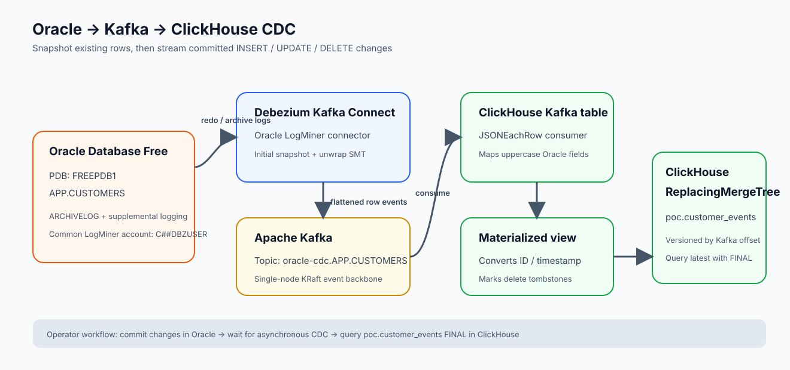

# Oracle to ClickHouse CDC POC

A local Docker Compose project that streams Oracle table changes through Debezium and Kafka into ClickHouse. This guide is written for a fresh checkout and includes the Oracle setup required before starting CDC.



## What this starts

- **Oracle Database Free** source, with `APP.CUSTOMERS` and sample rows.
- **Debezium Kafka Connect** using Oracle LogMiner for initial snapshot plus ongoing inserts, updates, and deletes.
- **Kafka** in single-node KRaft mode as the event backbone.
- **ClickHouse** Kafka engine table and materialized view, writing to a versioned `ReplacingMergeTree` target.

## Requirements and Oracle image notes

- Docker Desktop or Docker Engine with Docker Compose v2.
- Allow about 6–8 GB of memory for the four services. Oracle's first initialization can take several minutes.
- The Compose file uses `gvenzl/oracle-free:23-slim`, a community-built image based on Oracle Database Free. It is not an Oracle-published image. The tag can move forward: on recent pulls it may run Oracle AI Database 26ai. The project uses Debezium Connect 3.5.0.Final, which supports Oracle 26ai version detection.
- Oracle Database Free has usage limits and Oracle license terms. Review those terms before using the image. If the community image is unavailable, use Oracle's official Database Free container after accepting its license/sign-in requirements, or build an image from Oracle's Database Free RPM; adapt the init scripts if the image layout differs.
- Sample credentials are intentionally simple and are for local testing only: Oracle SYS/SYSTEM `oracle`, source app user `APP/app`, Debezium common user `C##DBZUSER/dbz`, and ClickHouse user `default/clickhouse`. Replace them before using the stack outside a trusted local environment. Oracle app and ClickHouse values are configurable in `.env`; the Debezium password must also match in `connector/oracle-customers.json` and `scripts/setup-debezium-user.sql`.
- `.env` and macOS `.DS_Store` files are excluded by `.gitignore`. Commit `.env.example`, not your local `.env`.
- References: [Oracle Database Free](https://www.oracle.com/database/free/), [Oracle Free license](https://www.oracle.com/downloads/licenses/oracle-free-license.html), [community Oracle Free image](https://github.com/gvenzl/oci-oracle-free), and [Oracle Container Registry](https://container-registry.oracle.com/).

## Start from a clean checkout

Run all commands from this project's `outputs` directory.

### 1. Configure and start the containers

```sh
cp .env.example .env
docker compose up -d
docker compose ps
```

Wait until Oracle and Kafka are healthy and Connect and ClickHouse have started. Oracle initialization runs the scripts under `oracle/init` only when its data volume is empty. It creates the common Debezium account, enables supplemental logging, and creates `APP.CUSTOMERS` with two rows.

### 2. Enable Oracle ARCHIVELOG mode

LogMiner requires Oracle `ARCHIVELOG` mode. The initial database cannot switch modes while open, so perform this one-time restart inside Oracle before registering the connector:

```sh
docker compose exec oracle sqlplus / as sysdba
```

At the `SQL>` prompt, enter:

```sql
SHUTDOWN IMMEDIATE;
STARTUP MOUNT;
ALTER DATABASE ARCHIVELOG;
ALTER DATABASE OPEN;
SELECT LOG_MODE FROM V$DATABASE;
EXIT;
```

Confirm the query returns `ARCHIVELOG`. This changes Oracle's database mode persistently; it does not require restarting the full Compose stack.

### 3. Register the Debezium connector

```sh
sh ./scripts/register-connector.sh
curl -s http://localhost:8083/connectors/oracle-customers/status
```

Wait for both the `connector` and its `task` to show `RUNNING`. The connector takes an initial snapshot, then streams committed changes. Connect may take a short time to finish starting on the first run.

### 4. Confirm the initial snapshot in ClickHouse

```sh
curl -sS -u default:clickhouse \
  --data-binary 'SELECT * FROM poc.customer_events FINAL ORDER BY id' \
  http://localhost:8123/
```

The initial result should include:

| id | name | email | is_deleted |
|---:|---|---|---:|
| 1 | Ada Lovelace | ada@example.test | 0 |
| 2 | Grace Hopper | grace@example.test | 0 |

ClickHouse stores the Oracle timestamp as a readable timestamp string. The `FINAL` modifier selects the latest version per customer ID.

## Demonstrate INSERT, UPDATE, and DELETE

Connect to the Oracle application PDB:

```sh
docker compose exec oracle sqlplus APP/app@//localhost:1521/FREEPDB1
```

At `SQL>`, run and commit each change:

```sql
INSERT INTO CUSTOMERS (ID, NAME, EMAIL)
VALUES (3, 'Katherine Johnson', 'katherine@example.test');
COMMIT;

UPDATE CUSTOMERS
SET EMAIL='ada.lovelace@example.test', UPDATED_AT=SYSTIMESTAMP
WHERE ID=1;
COMMIT;

DELETE FROM CUSTOMERS WHERE ID=2;
COMMIT;
```

Wait a few seconds, then query ClickHouse again:

```sh
curl -sS -u default:clickhouse \
  --data-binary 'SELECT * FROM poc.customer_events FINAL ORDER BY id' \
  http://localhost:8123/
```

Expected logical result: ID 1 has the updated email, ID 3 is present, and ID 2 has `is_deleted=1`. Deletes are represented as retained tombstone rows; filter them from live results with:

```sh
curl -sS -u default:clickhouse \
  --data-binary 'SELECT * FROM poc.customer_events FINAL WHERE is_deleted = 0 ORDER BY id' \
  http://localhost:8123/
```

## Project files

```text
.
├── docker-compose.yml
├── .env.example
├── README.md
├── connector/oracle-customers.json
├── oracle/init/                 # First-boot CDC grants, supplemental logging, sample table/data
├── clickhouse/init/             # Kafka table, materialized view, target table
├── clickhouse/migrate-uppercase-fields.sql
├── scripts/                     # Connector registration and common-user setup
└── docs/
    ├── methods.md
    └── oracle-clickhouse-cdc.svg
```

## Troubleshooting and operations

### Existing Oracle volume

Oracle init scripts run only for a new/empty data volume. If the volume predates the common Debezium account, run:

```sh
docker compose exec -T oracle sqlplus / as sysdba < scripts/setup-debezium-user.sql
```

Then check `ARCHIVELOG` mode and register/update the connector as above.

### Connector status and logs

```sh
curl -s http://localhost:8083/connectors/oracle-customers/status
docker compose logs --tail=100 connect
```

If the task reports `ORA-01031` for `ALTER SESSION SET CONTAINER=CDB$ROOT`, verify the connector uses the common account `C##DBZUSER`, not the local `APP` account. If it reports that archive logging is disabled, run the ARCHIVELOG setup above and restart only the failed task:

```sh
curl -i -X POST 'http://localhost:8083/connectors/oracle-customers/restart?includeTasks=true&onlyFailed=true'
```

### ClickHouse credentials and reinitialization

The ClickHouse container disables remote network access for `default` when no password is configured. Compose sets the local demo password to `clickhouse`; change `CLICKHOUSE_PASSWORD` in `.env` and use that value with `curl -u` if desired. Recreate ClickHouse to apply a changed password:

```sh
docker compose up -d --force-recreate clickhouse
```

If the ClickHouse target contains rows with missing/default values because its column names do not match the Oracle event fields, the migration below clears the target and replays Kafka using a fresh consumer group:

```sh
docker compose exec -T clickhouse clickhouse-client --user default --password clickhouse < clickhouse/migrate-uppercase-fields.sql
```

Replace the password if you changed it. The migration does not alter Oracle or Kafka data.

### Stop and reset

```sh
docker compose down       # Stop services; preserve volumes
docker compose down -v    # Delete volumes and all demo data; next startup is a clean initialization
```

### POC limits

Kafka is one KRaft broker with replication factor 1; this is not highly available. The ClickHouse materialized view uses the Kafka message offset as a version and assumes this demo topic is single-partition. Kafka, Oracle, and ClickHouse data are persisted in local named volumes. This project is for local evaluation, not production deployment.

## Further reading

- [Architecture and methods](docs/methods.md)
- [Standalone architecture diagram](docs/oracle-clickhouse-cdc.svg)
- [Debezium Oracle connector documentation](https://debezium.io/documentation/reference/connectors/oracle.html)
